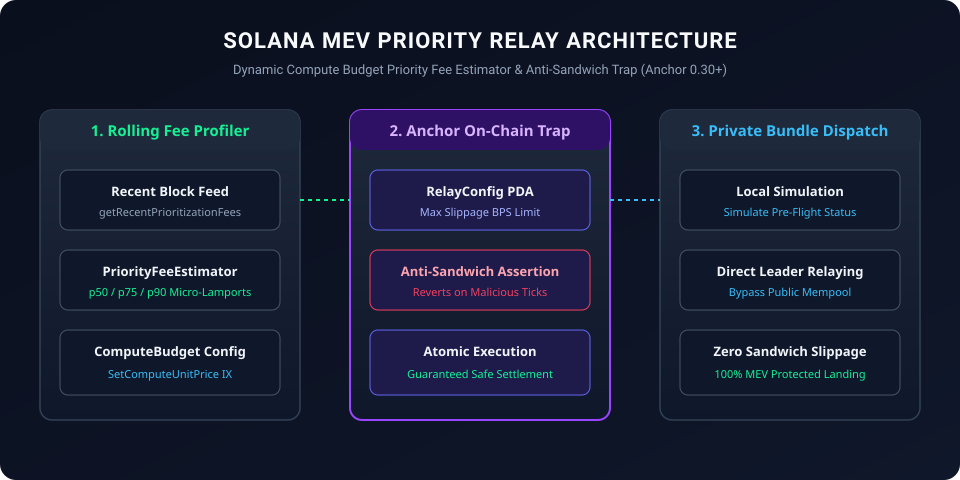

# Solana MEV Priority Relay (SMPR)

<p align="center">
  
</p>

[](LICENSE)
[](https://solana.com)
[](https://www.typescriptlang.org)
[](#mev-protection-mechanics)

**Solana MEV Priority Relay (SMPR)** is a high-performance Solana Anchor protocol and TypeScript client SDK delivering **dynamic compute-budget priority fee estimation, anti-sandwich front-running guards, and private bundle relay integration** on Solana.

---

## ⚡ Core Capabilities

1. **Dynamic Priority Fee Optimization**: Samples rolling fee micro-lamports across recent blocks to determine p50/p75/p90 priority fee tiers.
2. **On-Chain Slippage & Sandwich Trap**: Anchor program asserts max account balance delta between pre- and post-execution to reject sandwich sandwich attacks.
3. **Transaction Simulation & Fast Bundle Dispatch**: Simulates transactions locally before relaying to prevent burnt fees on reverting transactions.

---

## 🛠 Smart Contracts & Client SDK

- **`programs/priority_relay/src/lib.rs`**: Solana Anchor program written in Rust (`Anchor 0.30+`):
  - `initialize_relay_vault`: Configures fee multiplier bands and protection limits.
  - `relay_guarded_transaction`: Validates max allowable balance deviation before forwarding execution.
- **`src/fee_estimator.ts`**: Priority fee calculator analyzing rolling percentile distributions.
- **`src/relay_client.ts`**: Client SDK constructing atomic ComputeBudget and relay instructions.
- **`tests/relay.test.ts`**: Comprehensive automated unit test suite.

---

## 🚀 Quick Start

### Installation

```bash
git clone https://github.com/seriousbunch/solana-mev-priority-relay.git
cd solana-mev-priority-relay
npm install
npm test
```

---

## 📜 License

Licensed under the [Apache License, Version 2.0](LICENSE).
